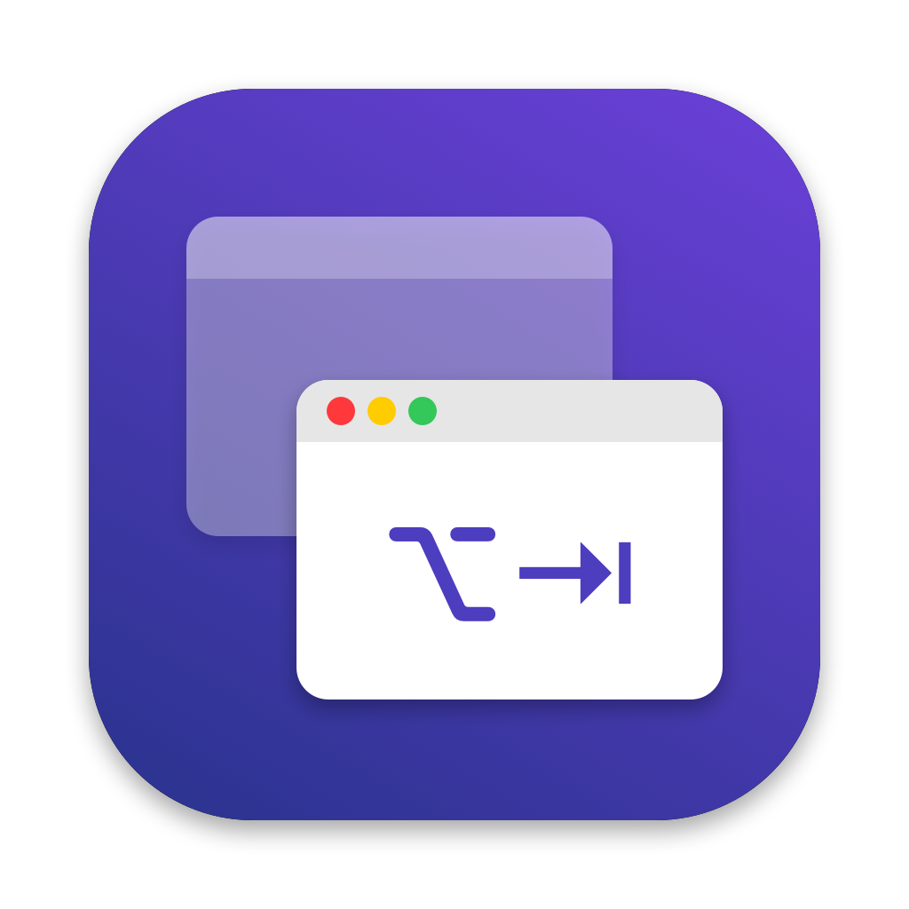
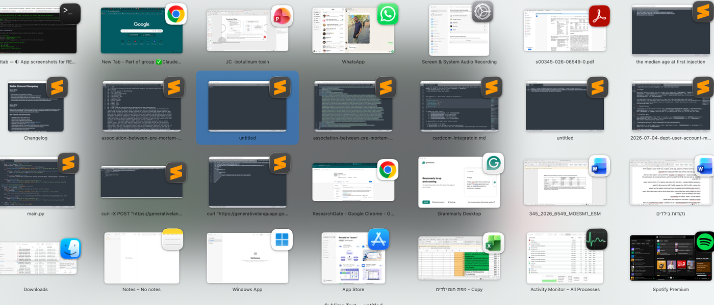
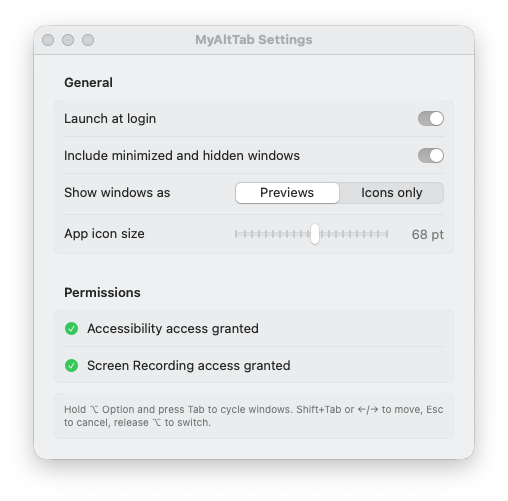

<div align="center">
  
  <h1>MyAltTab</h1>
  <p>Windows-style Alt+Tab window switcher for macOS.<br>Switch between individual <strong>windows</strong> — not just apps — using ⌥ Option + Tab.</p>
</div>

---



## Features

- **Window-level switching** — each open window gets its own tile, just like Windows Alt+Tab
- **Live previews** — see a thumbnail of each window before switching
- **Keyboard navigation** — Tab/Shift+Tab to cycle, arrow keys to move between tiles, Esc to cancel
- **Click to switch** — click any tile to jump to that window
- **Configurable** — choose previews or icons-only; adjust icon badge size; include/exclude minimized windows

## Requirements

- macOS 14 (Sonnet) or later
- Xcode Command Line Tools (`xcode-select --install`)

## Install

```sh
git clone https://github.com/guyen10/MyAltTab
cd MyAltTab
./build.sh
open ~/Applications/MyAltTab.app
```

`build.sh` asks for access to the signing keychain's password in your login keychain on every build. Click **Allow**, not **Always Allow**, so other programs can't sign code as MyAltTab and inherit its permissions.

To install on another Mac, copy `build/MyAltTab.zip`, unzip it and move `MyAltTab.app` to `/Applications` **before** opening it. Apps opened from Downloads run from a randomized temporary location, which breaks Launch at Login and Relaunch. The app is self-signed and not notarized, so open it the first time with right-click → **Open**.

On first launch, grant **Accessibility** access when prompted (System Settings → Privacy & Security → Accessibility). The app starts working as soon as access is granted.

For window previews, also grant **Screen Recording** access (System Settings → Privacy & Security → Screen & System Audio Recording), then relaunch via Settings → Relaunch.

## Usage

| Key | Action |
|-----|--------|
| **⌥ Tab** | Open switcher / move to next window |
| **⌥ Shift+Tab** | Move to previous window |
| **← → ↑ ↓** | Navigate tiles |
| **Esc** | Cancel (return to original window) |
| **Release ⌥** | Switch to selected window |

Click any tile to switch immediately.

## Settings



Access via the menu bar icon → **Settings…** (or **⌘,**).

- **Launch at login** — start automatically when you log in
- **Include minimized and hidden windows** — show all windows, not just visible ones
- **Show windows as** — toggle between live previews and app icons
- **App icon size** — adjust the badge icon size in preview tiles

## How it works

MyAltTab uses a CGEvent tap to intercept ⌥ Tab globally, then shows a floating panel listing every window on the current Space in most-recently-used order. Releasing ⌥ raises the selected window.

Builds are signed with a self-signed certificate (created once at first build) so macOS keeps Accessibility and Screen Recording permissions across rebuilds.
